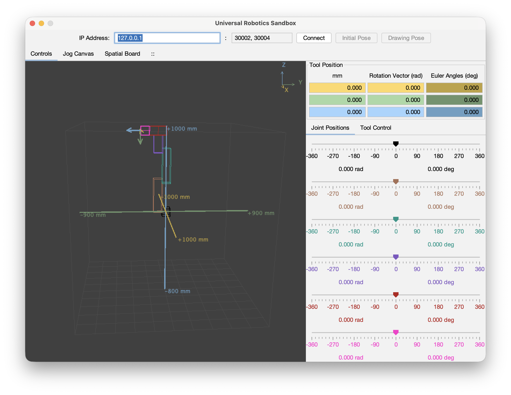

Project:

# Remote Operation and Visualization of Embodied Robots (ROVER)

Module:

## ROVER Desktop

ROVER Desktop is a **fully functional desktop application and real-time digital twin** for Universal Robots e-Series robotic arms. Built around the [RTDE4J](https://github.com/javiergs/rtde4j-getting-started) Java ecosystem, it connects to a physical Universal Robots controller or URSim to visualize the robot's current state and issue robot motion commands.

Unlike an offline 3D model, the application supports **continuous RTDE robot-state streaming and interactive motion control**. The released application has been tested with both a physical Universal Robots robot and URSim.

## Features

- **Live robot digital twin** — a 3D view of the connected robot, including workspace references and coordinate axes, updated from robot feedback.
- **Continuous RTDE feedback** — receive robot-state data during a connection to the controller or URSim.
- **Robot motion control** — send motion commands to a connected robot or simulator and observe the result in the interface.
- **Six-joint interface** — inspect and adjust joint controls, with angles displayed in degrees and radians.
- **Tool pose readouts** — inspect Cartesian position and orientation information.
- **Jog Canvas** — a motion-vector interaction interface.
- **Spatial Board** — a grid-based spatial interaction view.
- **Preset poses** — access *Initial Pose* and *Drawing Pose* controls.
- **Connection settings** — configure the controller or simulator IP address and communication ports.

## Implementation and validation

**ROVER Desktop v1.0.0 is an implemented and released application**, not a visualization mockup. It has been validated with a physical Universal Robots arm and with URSim, including:

- Continuous RTDE state streaming from the connected robot or simulator.
- Robot motion commands issued through the desktop application.
- Live 3D visualization and readouts associated with robot operation.

ROVER Desktop is an application-level example of connecting Java-based visualization and interactive robot control with RTDE4J. The [RTDE4J getting-started repository](https://github.com/javiergs/rtde4j-getting-started) provides introductory examples and documentation; its minimal introductory client is not a complete description of the capabilities integrated into this desktop application.

## Download

Download **[ROVER Desktop v1.0.0](https://github.com/javiergs/rover-desktop/releases/tag/v1.0.0)** from the release assets:

- **macOS (Apple silicon):** DMG installer.
- **Windows (x64):** MSI installer.

The installers retain the original Universal Robotics Desktop filenames. GitHub's automatically generated source archives contain this public documentation repository rather than the installed application.

## ROVER Desktop v2.0.0 prerelease

The [v2.0.0 prerelease](https://github.com/javiergs/rover-desktop/releases/tag/v2.0.0) adds a built-in UR3e simulator, tool paths and drawing playback, and a bundled Claude Desktop bridge. The stable v1.0.0 installers remain available above.

1. Install and open ROVER Desktop.
2. Choose **Help → Set up Claude Desktop…**. If ROVER detects Claude on first launch, it offers the same setup.
3. Confirm the change and restart Claude. Setup backs up your Claude configuration and updates only the ROVER entry.
4. Open ROVER normally when you want Claude to use it. Select **Enable MCP (offline simulation)** while disconnected to allow simulator motion.

Claude’s bridge connects to the running app and asks you to open ROVER if it is closed. For a manual Java 21 setup, run the prerelease’s MCP JAR with `--mcp-bridge`.

## Getting started

1. Download and install the [latest published release](https://github.com/javiergs/rover-desktop/releases).
2. Start with **URSim** rather than a physical robot. The [URSim setup guide](https://github.com/javiergs/rtde4j-getting-started/blob/main/docs/ursim-setup.md) describes a Docker-based environment.
3. Launch ROVER Desktop and enter your robot or simulator IP address and relevant ports.
4. Establish the connection and observe live robot-state feedback in the digital twin.
5. Test the motion controls in URSim and verify that the visualization reflects the resulting robot state.
6. Move to a physical robot only after validating the environment and applicable safety procedures.

Connection settings include Universal Robots interfaces on ports **30002** and **30004**. The required network configuration depends on your controller or simulator.

## Safety

**Use URSim first.** ROVER Desktop is experimental research software and is **not a safety-rated robot controller**. The desktop interface does not replace PolyScope, protective stops, emergency-stop equipment, or the safety procedures required for a physical robot. Motion commands to a physical robot require an appropriate risk assessment, a supervised workspace, and suitable safeguards. An AI-agent integration must also enforce independent command validation and safety constraints.

## Feedback

[Open an issue](https://github.com/javiergs/rover-desktop/issues/new/choose) to report a bug, suggest a feature, or flag unclear documentation.

For bugs, include the ROVER Desktop version, your operating system, and whether you were using URSim, a physical robot, or the app offline. Tell us how to reproduce the problem, what you expected, and what happened. Sanitized logs or screenshots are welcome.

For problems with a Java example or the URSim setup guide, use [RTDE4J Getting Started issues](https://github.com/javiergs/rtde4j-getting-started/issues/new/choose).
