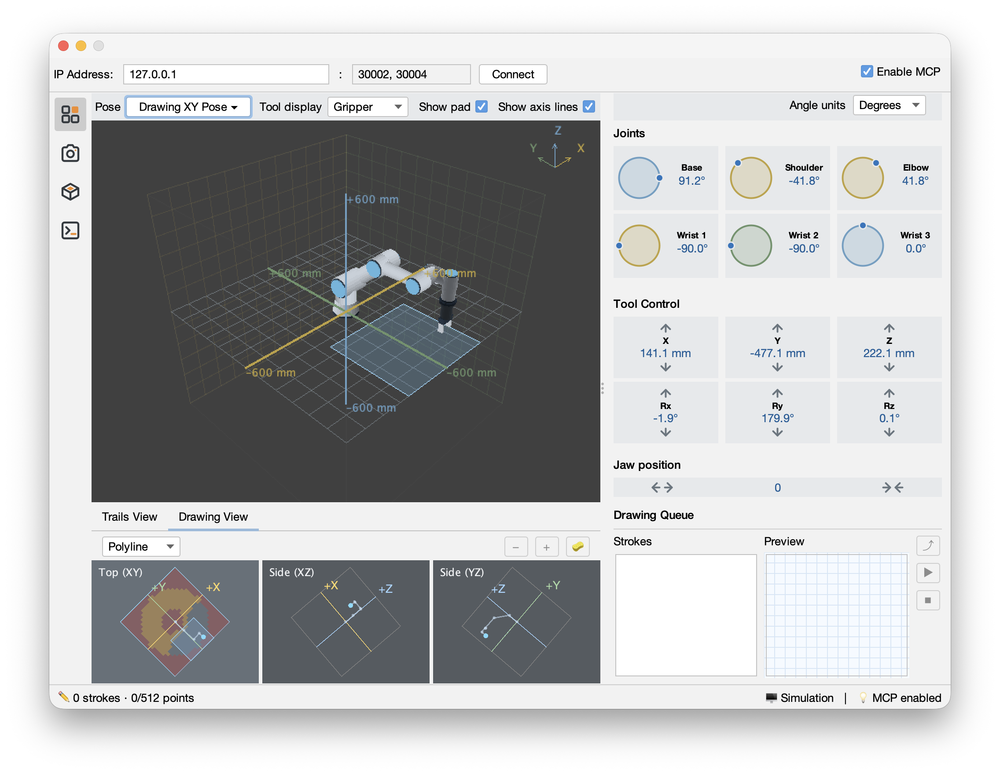

# ROVER Desktop

**ROVER — Remote Operation and Visualization of Embodied Robots**

ROVER Desktop is an interactive application for exploring, visualizing, and controlling Universal Robots e-Series robotic arms. It works **offline as a robot simulator** or, when connected to a Universal Robots controller or URSim, as a **live digital twin** using real-time RTDE feedback.

Explore robot poses, draw and preview tool paths, work with a Robotiq gripper and wrist camera, or connect an AI assistant through the Model Context Protocol (MCP).

## Download ROVER Desktop

**Latest stable release: [v2.1.0](https://github.com/javiergs/rover-desktop/releases/tag/v2.1.0)**

- **macOS (Apple Silicon):** [Download ROVER Desktop 2.1.0 — DMG](https://github.com/javiergs/rover-desktop/releases/download/v2.1.0/ROVER.Desktop-2.1.0.dmg)
- **Windows (64-bit):** [Download ROVER Desktop 2.1.0 — MSI](https://github.com/javiergs/rover-desktop/releases/download/v2.1.0/ROVER.Desktop-2.1.0.msi)

The installers include the application and its Java runtime; no separate Java installation is required. On macOS, open the DMG and move the application into Applications. On Windows, run the MSI installer.

See [all releases](https://github.com/javiergs/rover-desktop/releases) for previous versions and detailed release notes. GitHub's automatically generated source-code archives refer to this public documentation repository, **not** to the private application source code.

## What you can do

- **Simulate a UR3e offline.** Explore the 3D robot, change six joint angles, inspect Cartesian tool coordinates, and use preset poses without a physical robot or URSim.
- **Connect to a robot or URSim.** See continuously updated RTDE telemetry in the 3D visualization and use desktop controls to send supported motion commands.
- **Draw and preview.** Create strokes in **Drawing View** using Freehand or Polyline, share them through the **Drawing Queue** with MCP, preview motion in the simulator, and start physical drawing from the desktop controls. Observe connected playback through live RTDE feedback.
- **Explore the drawing workspace.** Show drawing-pad overlays, tool paths, and relevant workspace references.
- **Operate a Robotiq Hand-E.** Use open/close controls and view live jaw-position feedback when the gripper is detected, or experiment with simulated gripper behavior offline.
- **View the wrist camera.** Watch a continuous camera feed, rotate the displayed image, and request snapshots through MCP when the camera is available.
- **Experiment with 3D scanning.** The **Scan** tab provides camera calibration, multi-view capture, and point-cloud reconstruction previews. This workflow is experimental.
- **Connect an AI assistant.** Use the bundled Claude Desktop bridge to inspect simulated robot state, stage drawings, retrieve drawing-pad coordinates, and request wrist-camera images.

## Get started — no robot required

1. Download and install [ROVER Desktop v2.1.0](https://github.com/javiergs/rover-desktop/releases/tag/v2.1.0).
2. Open ROVER Desktop. **Leave the robot disconnected** to use the built-in simulator.
3. Choose **Pose → Initial Pose** to start from a known configuration, then explore the 3D view and six joint controls.
4. Open **Drawing View** to create a path. Use the **Drawing Queue** and **Preview** to inspect simulated movement before considering physical playback.

You can use offline simulation without installing ROS, running URSim, or connecting robot hardware.

## Connect to URSim or a physical robot

To explore live robot feedback safely, **start with URSim**. The [URSim setup guide](https://github.com/javiergs/rtde4j-getting-started/blob/main/docs/ursim-setup.md) provides instructions for a simulator environment.

1. Launch URSim and ensure it is reachable from the computer running ROVER Desktop.
2. Enter the controller or simulator **IP address** in ROVER Desktop and select **Connect**.
3. Observe the connected robot state and tool readouts. Use the desktop motion controls in a supervised test environment.
4. Only move to physical hardware after validating the workflow in URSim and checking the required robot safety procedures.

ROVER uses **URScript on port 30002** for supported robot commands and **RTDE on port 30004** for continuous robot-state feedback. Network configuration and robot permissions depend on your setup.

**Offline vs. connected:** Disconnected ROVER is a simulator. Connected ROVER can act as a digital twin, synchronized with the robot through RTDE.

## Use ROVER with Claude Desktop (MCP)

The installers include a Claude Desktop bridge. You do not need to configure Java or a separate MCP server manually.

1. Install and open ROVER Desktop.
2. Choose **Help → Set up Claude Desktop…**. When Claude Desktop is detected on first launch, ROVER may also offer this setup automatically.
3. Confirm the setup, which backs up the Claude configuration and updates its ROVER entry, then restart Claude Desktop.
4. Keep the ROVER window open while using Claude. **Enable MCP** is selected by default; clear it in ROVER to disable MCP access.

Claude can read simulated joint and tool state, work with the Drawing Queue, request drawing-pad coordinates, and retrieve a camera snapshot when available. **MCP robot-motion tools operate in offline simulation; physical drawing playback must be initiated by an operator in ROVER Desktop.** The queue can be inspected or staged while the robot is connected.

## Validation and limitations

ROVER Desktop has been tested with **URSim and a physical Universal Robots arm** for connected telemetry and motion commands. In v2.1.0, the **Robotiq Hand-E gripper and wrist-camera preview** have also been tested with physical hardware.

The **3D scanning and reconstruction workflow remains experimental** and needs further validation on physical hardware. Results should not be treated as calibrated measurements without that validation.

### Safety

**ROVER Desktop is experimental research software, not a safety-rated robot controller.** Use URSim first. Physical robot operation requires appropriate supervision, risk assessment, safeguards, and compliance with the robot's safety procedures. The application does not replace PolyScope, protective stops, emergency-stop equipment, or independent safety checks. Review any queued path before starting physical motion; AI-generated commands should never bypass operator approval and robot safety protections.

## Explore related projects

- **[ROVER Web](https://javiergs.github.io/rover-web/)** — Explore a UR3e in a browser with interactive 3D simulation, joint controls, tool readouts, and an MQTT playground. The web version does not directly control a physical robot.
- **[RTDE4J Getting Started](https://github.com/javiergs/rtde4j-getting-started)** — Learn about Java connectivity and RTDE communication with Universal Robots controllers and URSim.

## Feedback and support

Found a problem or have an idea? [Open an issue](https://github.com/javiergs/rover-desktop/issues/new/choose).

For a bug report, include the ROVER Desktop version, operating system, whether you were running offline, with URSim, or with a physical robot, and steps to reproduce the issue. Screenshots and sanitized logs are helpful. For issues specific to the RTDE4J examples or URSim setup guide, use [RTDE4J Getting Started issues](https://github.com/javiergs/rtde4j-getting-started/issues/new/choose).
